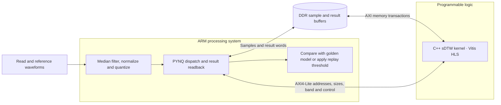

# PocketFilter

PocketFilter is an FPGA prototype for matching recorded nanopore current waveforms on the Real Digital AUP-ZU3. Given a read window and a shorter reference waveform, it uses window-constrained subsequence dynamic time warping (sDTW) to find the minimum-cost alignment. The matcher returns a distance and the zero-based, inclusive interval in the read. The Python replay applies a configurable threshold to produce a KEEP or REJECT decision.

**Implementation status.** The Python golden model and C++ kernel have been verified on a workstation and in Verilog co-simulation. Vivado routed both the 4 GB and 8 GB designs at a 100 MHz clock constraint. Physical board replay, end-to-end performance and accuracy on independently labeled nanopore reads remain open.

## Architecture

PocketFilter computes the local cost as the absolute difference between two samples. An alignment can advance along either waveform or both, within a band around each candidate start. The band limits allowable timing variation and the number of positions the kernel evaluates. The Python golden model defines the scoring, endpoint and tie behavior.



The workstation model and board host use Python. Vitis HLS translates the C++ kernel to RTL and exports it as IP. Vivado Tcl configures the clock, reset, processing system and AXI interconnect for the selected DDR variant. The PYNQ demonstration checks each returned word against the integer golden model. [Software design and call graphs](docs/design/software.md) · [Team Level 1 schematic](docs/design/level-1-schematic.pdf)

| Interface | Contract |
| --- | --- |
| Waveform input | One finite numeric sample per line in each headerless file. Preprocessing applies an edge-padded median filter and population z-score normalization. |
| Accelerator input | Signed 16-bit samples scaled by 1024. Maximum read and reference lengths are 512 and 128 samples. Band half-width is 0–16 samples. |
| Accelerator output | Four signed 32-bit words in order: status, integer distance, start and end. Status 0 is success, 1 is invalid input and 2 is no feasible path. Status 1 or 2 returns −1 in the remaining words. |


[Algorithm specification](docs/design/sdtw.md) · [Editable TikZ figure](docs/design/alignment-band.tex)

## Quick start

Use Python 3.11 and a POSIX-compatible shell from the repository root. The example uses identical three-sample waveforms and runs without third-party Python packages, FPGA tools or submodules.

```sh
mkdir -p hardware/build
printf '0\n1\n0\n' > hardware/build/example.csv
python3 software/golden_model.py hardware/build/example.csv hardware/build/example.csv \
  --median 1 --width 0 --threshold 0 --hls
```

Expected output:

```json
{"match": {"distance": 0, "start": 0, "end": 2}, "distance_scale": 1024, "decision": "KEEP"}
```

The distance divided by `distance_scale` gives the score in normalized units. For floating-point replay, omit `--hls`. For the native C++ testbench, use a C++17 compiler:

```sh
python3 hardware/hls/generate_vectors.py hardware/build/vectors.txt
c++ -std=c++17 -O2 -Wno-unknown-pragmas \
  hardware/hls/sdtw.cpp hardware/hls/testbench.cpp -o hardware/build/sdtw-test
hardware/build/sdtw-test hardware/build/vectors.txt
```

This command runs 270 synthetic vectors. The archived baseline adds three pinned fixtures. [Archived model reproduction and dependencies](software/README.md) · [Native and HLS test procedures](hardware/hls/README.md)

## Verification

| Layer | Observed result |
| --- | --- |
| Python reference | 1,260 small inputs agreed with independent enumeration of legal paths. |
| Native C++ and Vitis C simulation | Each matched all 273 synthetic vectors, including the three archived fixtures. |
| Verilog co-simulation | Exact agreement on all four result words for 270 synthetic inputs and eight recorded lambda controls. The recorded queries took 921,371–921,421 simulated cycles each. |
| PYNQ host | Seven workstation tests passed for register binding, memory and cache handling, and result checks. The host bound to both generated register maps. |
| Vivado 2024.2 | Both routed designs met the 100 MHz constraint with +6.149 ns worst setup slack, +0.010 ns worst hold slack and zero routed design-rule findings. Each used 5,355 LUTs, 8,282 registers, 1.5 block RAM tiles and zero DSPs. |

At the simulated 10 ns clock, the recorded queries took about 9.21 ms each in the kernel. Physical measurements must account for preprocessing, memory transfers, host dispatch and decision logging. A separate ECG200 experiment classified 72 of 100 held-out waveforms correctly and documents the threshold calibration workflow. [Verification reports](docs/validation/accelerator.md) · [Routed reports](docs/validation/vivado-2024.2) · [Recorded-data methods](docs/validation/recorded.md)

## Build and deploy

### Build from source

Use AMD Vitis HLS and Vivado 2024.2 with Zynq UltraScale+ device support. In a Linux shell with the AMD tools on PATH, export the kernel IP, then build the overlay with the Real Digital board preset. Set the last argument to the DDR capacity printed on the target board.

```sh
mkdir -p hardware/build
git clone https://github.com/RealDigitalOrg/aup-zu3-bsp.git hardware/build/bsp
git -C hardware/build/bsp checkout b595ecdf37c7204129517de1773b0895bcdcc2ed
POCKETFILTER_PYTHON=python3 POCKETFILTER_HLS_STAGE=ip \
  vitis-run --mode hls --tcl hardware/hls/run_hls.tcl
bash hardware/vivado/build_boards.sh hardware/build/bsp/board-files 4gb
```

The build stages the BIT file, matching HWH metadata and routed reports under `hardware/build/overlay/4gb/` and creates a timestamped deployment ZIP. [Build options and monitor](hardware/vivado/README.md) · [Vivado stage monitor](hardware/vivado/progress.py)

### Run the board acceptance test

| DDR marking | Deployment archive | ZIP SHA-256 |
| --- | --- | --- |
| 4G | [4 GB archive](deployment/pocketfilter-4gb.zip) | `d5a0ad55bd4126f97e0ca604ecb9b1fc00e99ca24d5a325d8ed722f2e412f3e7` |
| 8G | [8 GB archive](deployment/pocketfilter-8gb.zip) | `c92d81f526f01162bbce785d017b04a29657ad827fe98f1d7b5b6eefb29f5340` |

1. Select the archive and PYNQ image that match the board's DDR marking. Compare the archive hash with the table using `sha256sum` on Linux or `Get-FileHash -Algorithm SHA256` in PowerShell.
2. Extract the archive into the board's Jupyter workspace. Open `hardware/pynq/bringup.ipynb` and run all cells with exclusive access to the overlay.
3. Confirm the three transactions return `(0, 0, 0, 2)`, `(0, 2, 1, 2)` and `(2, -1, -1, -1)`. Save the executed notebook with the board revision, PYNQ image identifier and archive hash.

[Build provenance](HANDOFF.md#deploy-on-the-board) · [PYNQ setup and troubleshooting](hardware/pynq/README.md)

## Repository layout

| Path | Contents |
| --- | --- |
| [`software/`](software/) | Python golden model, replay tools and recorded-waveform evaluation |
| [`hardware/hls/`](hardware/hls/) | C++ kernel, vector generator, testbench and HLS flow |
| [`hardware/vivado/`](hardware/vivado/) | Board integration Tcl, build scripts and run monitor |
| [`hardware/pynq/`](hardware/pynq/) | Board host, workstation tests and acceptance notebook |
| [`deployment/`](deployment/) | Board-specific archives with checksums and provenance |
| [`docs/design/`](docs/design/) and [`docs/validation/`](docs/validation/) | Architecture, interfaces, test evidence and tool reports |
| [`references/`](references/) and [`academic/ECE396/`](academic/ECE396/) | Pinned baseline and project design archive |

PocketFilter is a University of Illinois Chicago engineering capstone by Team 12-R. The repository preserves the selected design alternative and its requirements alongside the current implementation. [Design selection](academic/ECE396/assignments/04-design-selection.pdf) · [Engineering handoff](HANDOFF.md) · [Roadmap](ROADMAP.md) · [SquiggleFilter research reference](https://github.com/Team-12R/SquiggleFilter/tree/21558e9701141c93c28a9f9c9c0316d2a50c5dfb)
