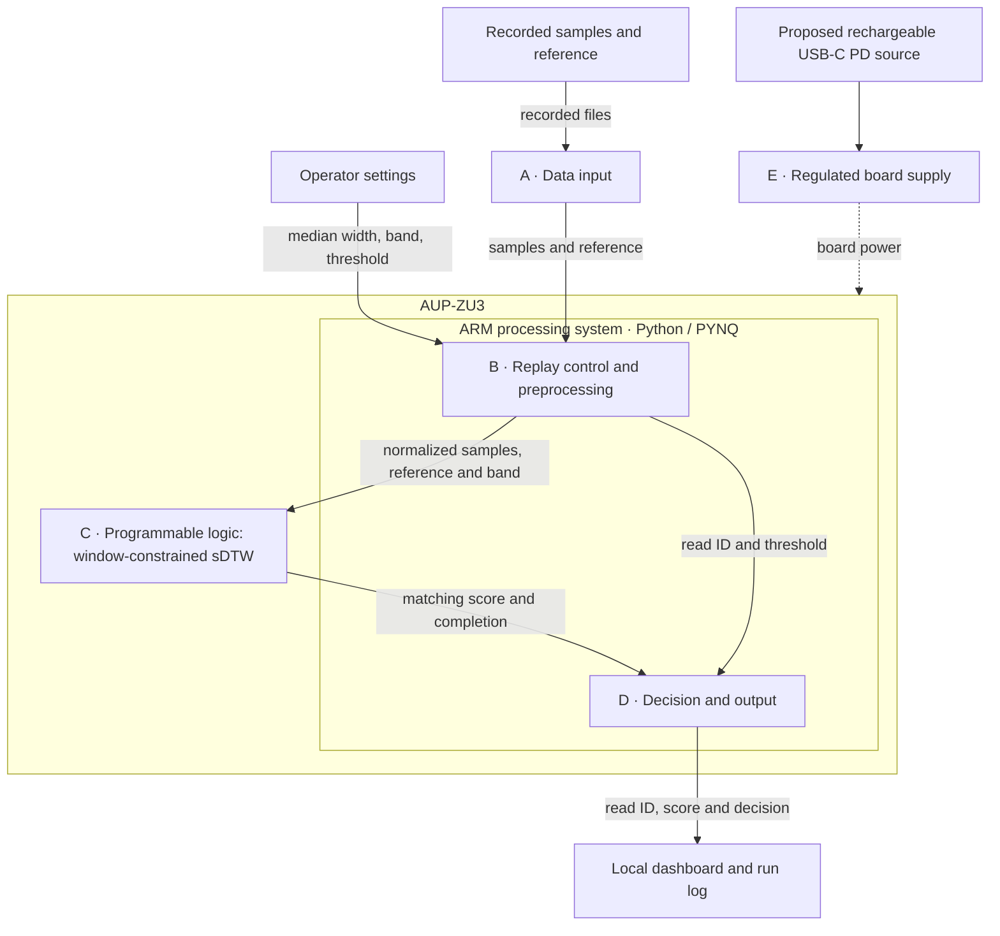
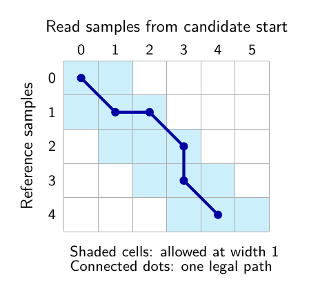
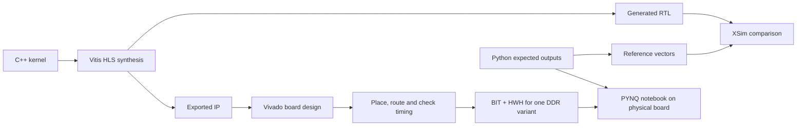

# PocketFilter

PocketFilter investigates how much signal matching a low-power FPGA can take off an embedded processor. Given a recorded nanopore current trace and a reference waveform, it finds the lowest-cost alignment, then logs the score, sample interval and KEEP or REJECT label for that read. A local replay lets an engineer inspect a decision and repeat it with the same inputs.

**Engineering status · 26 November 2026.** Vitis HLS 2024.2 synthesized the C++ matcher for the AUP-ZU3 and exported its IP. Verilog co-simulation matched the Python reference on 270 synthetic inputs and eight recorded lambda control reads. The board notebook compares four result words for each transaction. Physical performance and labeled nanopore accuracy are open measurements. [Hardware verification](docs/validation/accelerator.md) · [Recorded experiments](docs/validation/recorded.md) · [Build and deploy](hardware/vivado/README.md)

## How PocketFilter works

A nanopore instrument records a changing electrical current. PocketFilter asks a narrow question about a saved recording: where does a short reference waveform fit best, and how much do the two shapes differ there? Two recordings of a similar pattern can run at different speeds. The matcher allows a sample to line up with a neighboring sample, within a configurable window. A lower score means a closer fit. The host compares that score with a threshold to make a replay decision.

For example, suppose a short pulse appears halfway through a long recording and its peak lasts one sample longer than expected. The matcher tries different starting positions, permits the extra sample if the window allows it, and reports the start and end of its best alignment. The operator can inspect that interval and reproduce the score.

### What the team can run

| Component | What it does | Evidence |
| --- | --- | --- |
| Python golden model | Defines the expected score and interval for a pair of waveforms. Its integer mode gives the FPGA an exact comparison target. | 1,260 small cases checked against an independent enumeration of legal paths. [Algorithm and tie rules](docs/design/sdtw.md) |
| C++ accelerator | Moves the repetitive alignment calculations into a design that Vitis HLS translates into digital logic. The ARM processor handles input preparation and decisions. | Native C++ and AMD C simulation agreed with Python on 273 synthetic vectors. [Verification](docs/validation/accelerator.md) |
| Recorded replay | Reads actual electrical measurements, conditions them and checks all four output words. | Eight lambda controls matched Python in RTL simulation. A separate labeled ECG benchmark exercised the calibration workflow and scored 72/100 on its held-out split. Nanopore classification accuracy still needs independently labeled reads. [Data and splits](docs/validation/recorded.md) |
| Board integration | Connects the accelerator to processor-controlled memory on the 4 GB or 8 GB AUP-ZU3, builds a board-specific overlay and provides an offline comparison notebook. | Physical acceptance requires loading the matching overlay and saving the notebook results. [Build guide](hardware/vivado/README.md) · [Operator procedure](hardware/pynq/README.md) |

## Architecture

The Mermaid overview follows the five blocks and signals in the team’s [Level 1 schematic, final presentation slide 9](docs/design/level-1-schematic.pdf). The host conditions and quantizes inputs, writes DDR buffer addresses through AXI4-Lite and reads the kernel’s status, distance and interval from DDR.



The matcher allows local timing differences while limiting the alignment path to a band around each candidate start. A narrow band reduces work but can exclude a valid alignment. A wide band increases memory and compute cost. The first implementation question is whether the board can preserve the reference model’s decisions within its memory and power budget. [Design decision](academic/ECE396/assignments/04-design-selection.pdf) · [Software flowcharts and interface contracts](docs/design/software.md)



The illustration shows one legal alignment. PocketFilter sums the absolute differences along each candidate path and returns the least expensive one. [Editable TikZ source](docs/design/alignment-band.tex)

## From software to the board



For the eight recorded controls, XSim counted 921,371–921,421 cycles per query, about 9.21 ms at the simulated 10 ns clock. Physical replay will add processor, transfer and polling time. The notebook compares status, score and both endpoints and prints the processor-observed dispatch interval. [Cycle reports and measurement boundaries](docs/validation/accelerator.md)

**Check a running Vivado build locally.** From the repository root in the Linux build shell, run the command below. It reads Vivado’s run markers once a minute and exits with Ctrl+C. The build keeps running independently. The first implementation establishes the reference duration for later estimates.

```sh
watch -n 60 python3 hardware/vivado/progress.py hardware/build/build-boards-resumed.log
```

For a new run, save the output of `build_boards.sh` to a log and pass that path to the timer.

## Run the baseline

The standalone golden model needs Python 3.8 or newer and reads two headerless waveform CSVs. From the repository root:

```sh
git submodule update --init -- references/hamza-model
python software/golden_model.py references/hamza-model/test_inputs/read_001_target_match.csv references/hamza-model/test_inputs/target_ref.csv --width 15 --threshold 30
```

Add `--hls` to use the kernel's signed 16-bit input format and integer score. The JSON output includes a scale that converts the score back to normalized distance. [Vitis HLS project and testbench](hardware/hls/README.md)

### Reproduce the original sprint record

From a checkout of this repository, use Python 3.11 and Git. These package versions reproduce the tested workstation environment.

```sh
python -m venv .venv
# Activate .venv in your shell, then run:
python -m pip install numpy==1.26.4 matplotlib==3.8.0
git submodule update --init -- references/hamza-model
python software/verify_baseline.py references/hamza-model local-intake/replay
```

The verifier reads source from a pinned Git commit, generates fresh synthetic inputs, and writes the verified CSV and plot to the destination. A successful run ends with two PASS lines. [Reproduction details](software/README.md)

## Engineering records

| Record | Use |
| --- | --- |
| [Engineering report draft (PDF)](academic/ECE396/assignments/05-preliminary-design.pdf) | Original Level 1 schematic, preliminary design, simulation results, public design history and code appendix |
| [Sprint review](ROADMAP.md) | Evidence delivered, owners and open decisions |
| [Preliminary design](docs/design/software.md) | Platform split, software call graph, subroutine contracts and memory budget |
| [Validation](docs/validation/README.md) | Fixture results, timing boundary and first integration vector |
| [Hardware bring-up](hardware/README.md) | Evidence required for boot, processor replay and the first accelerator comparison |
| [Design history](academic/ECE396/README.md) | Requirements, alternatives, selection report and design presentations |

Team 12-R develops PocketFilter at the University of Illinois Chicago. The [team's SquiggleFilter import](https://github.com/Team-12R/SquiggleFilter) preserves the [research reference](https://github.com/TimD1/SquiggleFilter). The sprint uses [Hamza Kittaneh’s pinned model](https://github.com/Katanehh/PocketFilter-Team12R/tree/63b6728ac48b8ef733e98085a1fd69e4e4b4bf26).
