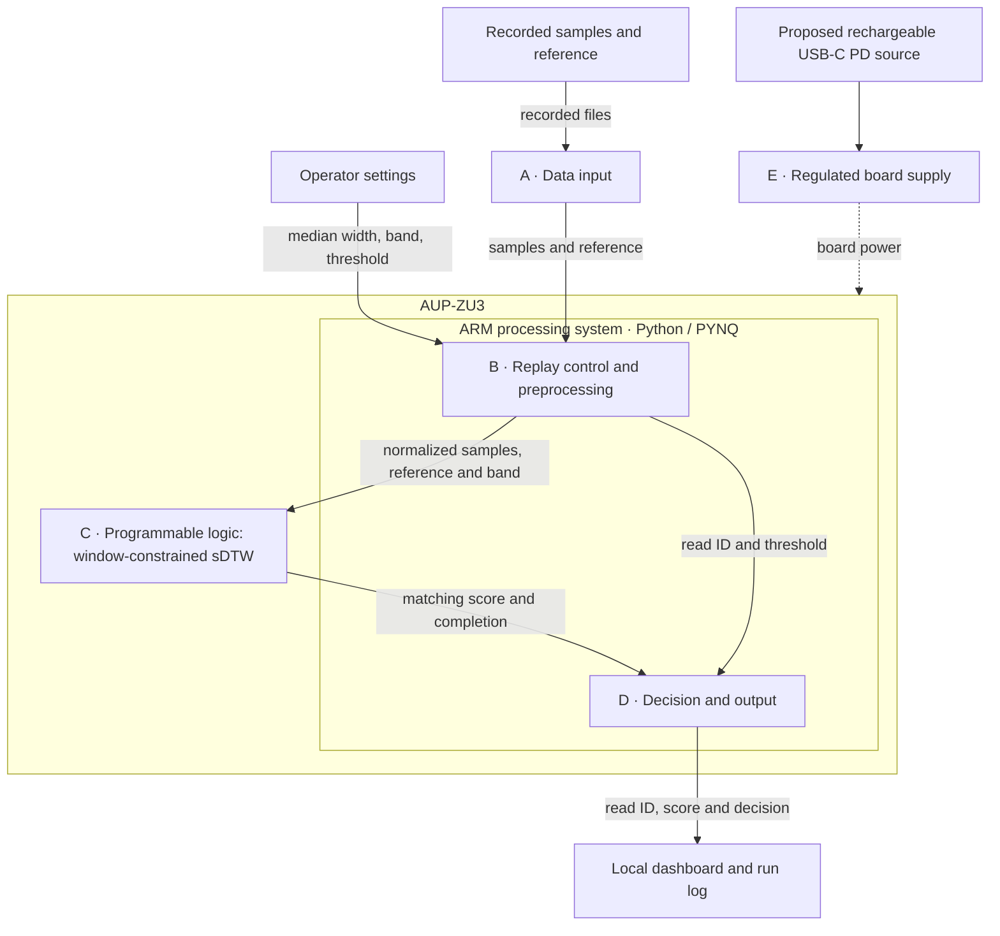

# PocketFilter

PocketFilter investigates how much signal matching a low-power FPGA can take off an embedded processor. Given a recorded nanopore current trace and a reference waveform, it finds the lowest-cost alignment, then logs the score, sample interval and KEEP or REJECT label for that read. A local replay lets an engineer inspect a decision and repeat it with the same inputs.

**Engineering status · 26 November 2026.** Vitis HLS 2024.2 synthesized the C++ matcher for the AUP-ZU3 and exported its IP. Verilog co-simulation matched the Python reference on 270 synthetic inputs and eight recorded lambda control reads. The board notebook compares four result words for each transaction. Physical performance and labeled nanopore accuracy are open measurements. [Hardware verification](docs/validation/accelerator.md) · [Recorded experiments](docs/validation/recorded.md) · [Build and deploy](hardware/vivado/README.md)

The implementation sprint adds a standalone Python golden model and a C++ matching kernel for the AUP-ZU3 Vitis HLS flow. [Implementation and verification](docs/design/sdtw.md)

## Architecture

The Mermaid overview follows the five blocks and signals in the team’s [Level 1 schematic, final presentation slide 9](docs/design/level-1-schematic.pdf). The host conditions and quantizes inputs, writes DDR buffer addresses through AXI4-Lite and reads the kernel’s status, distance and interval from DDR.



The matcher allows local timing differences while limiting the alignment path to a band around each candidate start. A narrow band reduces work but can exclude a valid alignment. A wide band increases memory and compute cost. The first implementation question is whether the board can preserve the reference model’s decisions within its memory and power budget. [Design decision](academic/ECE396/assignments/04-design-selection.pdf) · [Software flowcharts and interface contracts](docs/design/software.md)

## Run the baseline

The standalone golden model needs Python 3.8 or newer and reads two headerless waveform CSVs. From the repository root:

```sh
git submodule update --init -- references/hamza-model
python software/golden_model.py references/hamza-model/test_inputs/read_001_target_match.csv references/hamza-model/test_inputs/target_ref.csv --width 15 --threshold 30
```

Add `--hls` to use the kernel's signed 16-bit input format and integer score. The JSON output includes a scale that converts the score back to normalized distance. [Vitis HLS project and testbench](hardware/hls/README.md)

### Reproduce the original sprint record

From a checkout of this repository, use Python 3.11 and Git. These package versions reproduce the tested workstation environment.

```sh
python -m venv .venv
# Activate .venv in your shell, then run:
python -m pip install numpy==1.26.4 matplotlib==3.8.0
git submodule update --init -- references/hamza-model
python software/verify_baseline.py references/hamza-model local-intake/replay
```

The verifier reads source from a pinned Git commit, generates fresh synthetic inputs, and writes the verified CSV and plot to the destination. A successful run ends with two PASS lines. [Reproduction details](software/README.md)

## Engineering records

| Record | Use |
| --- | --- |
| [Engineering report draft (PDF)](academic/ECE396/assignments/05-preliminary-design.pdf) | Original Level 1 schematic, preliminary design, simulation results, public design history and code appendix |
| [Sprint review](ROADMAP.md) | Evidence delivered, owners and open decisions |
| [Preliminary design](docs/design/software.md) | Platform split, software call graph, subroutine contracts and memory budget |
| [Validation](docs/validation/README.md) | Fixture results, timing boundary and first integration vector |
| [Hardware bring-up](hardware/README.md) | Evidence required for boot, processor replay and the first accelerator comparison |
| [Design history](academic/ECE396/README.md) | Requirements, alternatives, selection report and design presentations |

Team 12-R develops PocketFilter at the University of Illinois Chicago. The [team's SquiggleFilter import](https://github.com/Team-12R/SquiggleFilter) preserves the [research reference](https://github.com/TimD1/SquiggleFilter). The sprint uses [Hamza Kittaneh’s pinned model](https://github.com/Katanehh/PocketFilter-Team12R/tree/63b6728ac48b8ef733e98085a1fd69e4e4b4bf26).
