# Software preliminary design

The [existing Level 1 schematic](level-1-schematic.pdf) is slide 9 of the [17-slide final presentation](../../academic/ECE396/presentations/final-presentation.pdf). Its five blocks are data input, control and preprocessing, matching, decision and output, and power. The table below adds software-level details such as inclusive span indices.

## Execution platform

The executable baseline runs under CPython and NumPy on a workstation. The proposed target is an AUP-ZU3 with the ARM processing system running Python/PYNQ for replay, preprocessing, control and logging. The programmable logic would run a Vitis HLS C/C++ matching kernel. Input packing, numeric precision, DMA framing, register addresses, clock rate and resource allocation are open design decisions. No custom circuit or semiconductor component selection is established for this sprint.

## Functional decomposition

The call graph shows the simulation entry point, its numerical blocks and evidence outputs. The detailed charts below follow the pinned source and the team’s verification harness.

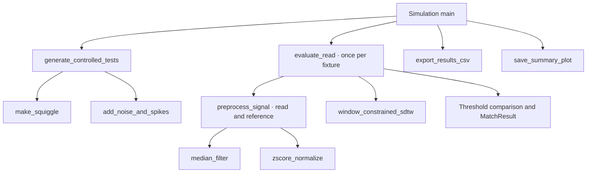

**Notation.** N is read length, M is reference length, L is a generic waveform length, K is median width, W is band half-width, and R is record count. Memory estimates describe the workstation implementation. Python containers, the plotting backend and operating-system overhead are additional.

**Memory example.** The longest fixture has N=342, M=100 and W=15. The two cost rows alone require 169,632 bytes (165.66 KiB). They scale with read length because this implementation evaluates all candidate starts in parallel. A future HLS core needs its own storage schedule, accumulator range and numeric error analysis before anyone can claim a BRAM footprint.

**Score semantics.** The local cost is absolute error between normalized samples. The allowed predecessors are diagonal, vertical and horizontal. Only valid positions inside each candidate’s band contribute. The last reference row selects the cheapest ending position. The decision compares the unrounded score to the threshold; the CSV stores four decimal places. An unreachable path has infinite distance and indices (−1, −1).

## Interfaces for board review

| Producer → consumer | Payload and meaning | Status |
| --- | --- | --- |
| Replay input → ARM control | Per-read ID, sample vector, target reference; units and metadata travel with the data | Model receives arrays; recorded-file adapter pending |
| ARM preprocessing → matcher | Normalized read and reference, lengths N and M, half-width W in samples | Python call implemented; transport and word format pending |
| Matcher → ARM decision | Minimum cumulative distance, inclusive start/end indices, completion or error | Python tuple implemented; hardware handshake pending |
| Control → decision | Threshold in the model’s distance units, read ID | Implemented in the host call |
| Decision → operator | ID, score, span, KEEP/REJECT and configuration | CSV implemented; dashboard pending |
| Regulated supply → board | Power input for the board assembly | Team to verify board revision, supply and permissible connection before bring-up |

[Source revision](https://github.com/Katanehh/PocketFilter-Team12R/tree/63b6728ac48b8ef733e98085a1fd69e4e4b4bf26) · [Verification harness](../../software/verify_baseline.py) · [Boundary checks](../../software/check_vectors.py)

## Orchestrate one replay

**Subroutine** `evaluate_read`

**Interface.** read_id: str, raw_signal: float64[N], target_ref: float64[M], window_width: int, threshold: float, median_kernel_size: int → MatchResult.

**Memory.** Retains clean read and reference (8(N+M) bytes), plus transient preprocessing or matcher workspace. Both signals are preprocessed on each call.

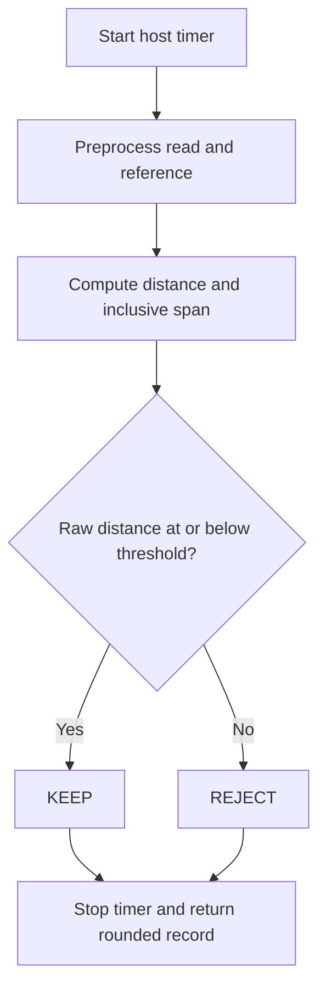

## Condition a waveform

**Subroutine** `preprocess_signal`

**Interface.** signal: float64[L], kernel_size: int → normalized: float64[L]. Called separately for the read and reference.

**Memory.** Keeps the filtered array while producing the normalized array. Each float64 vector costs 8L bytes.

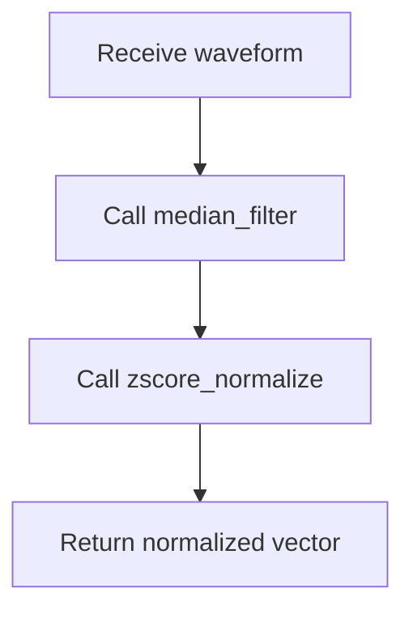

## Suppress isolated spikes

**Subroutine** `median_filter`

**Interface.** signal: float64[L], kernel_size: int → filtered: float64[L]. Supported replay uses positive odd K.

**Memory.** Edge-padded input has L+K−1 elements for odd K>1. The window view shares storage. The median reduction can use O(LK) temporary values.

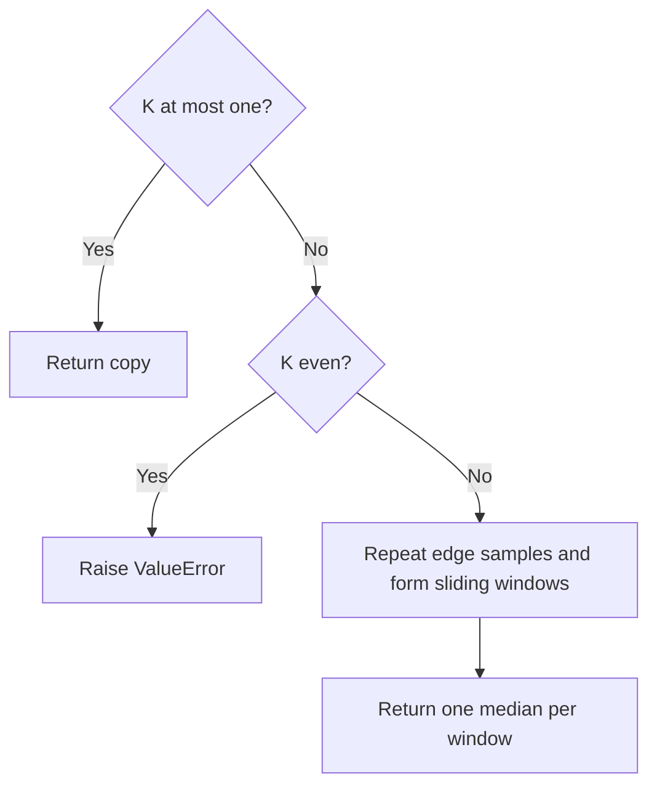

## Put amplitudes on a common scale

**Subroutine** `zscore_normalize`

**Interface.** signal: float64[L] → normalized: float64[L]. Uses population standard deviation.

**Memory.** Input and output each cost 8L bytes. Centering and reduction can allocate additional O(L) temporary storage.

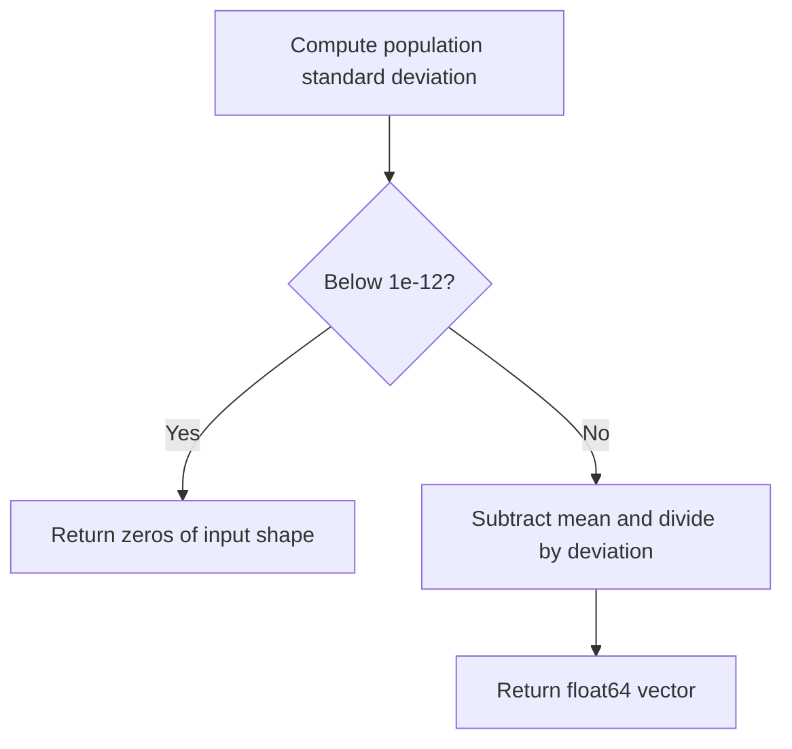

## Find the minimum-cost alignment

**Subroutine** `window_constrained_sdtw`

**Interface.** signal: float64[N], target_ref: float64[M], window_width: int → distance: float, start: int, end: int. Indices are zero-based and inclusive.

**Memory.** Two float64 cost rows with N(2W+1) entries each use 16N(2W+1) bytes. Index, validity and cost temporaries add O(N). The matcher does O(MN(2W+1)) work.

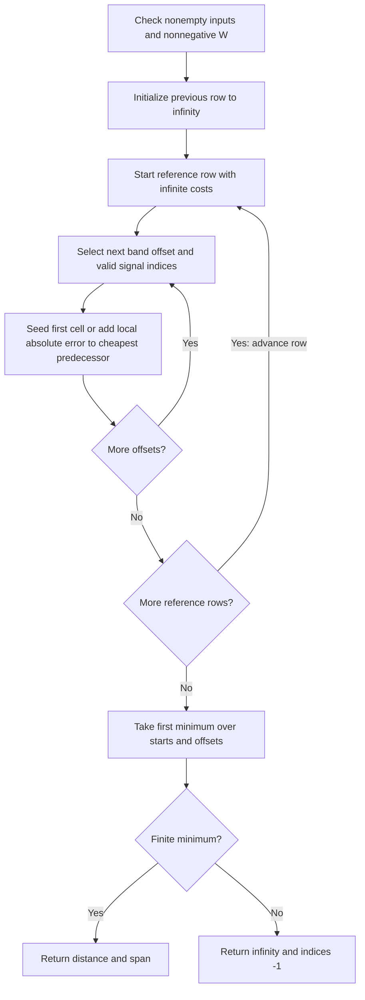

## Persist the replay log

**Subroutine** `export_results_csv`

**Interface.** results: nonempty list[MatchResult], csv_path: Path → CSV file; Python return None.

**Memory.** Retains R result records upstream. The writer creates one record dictionary at a time. Scalar timing is in host milliseconds.

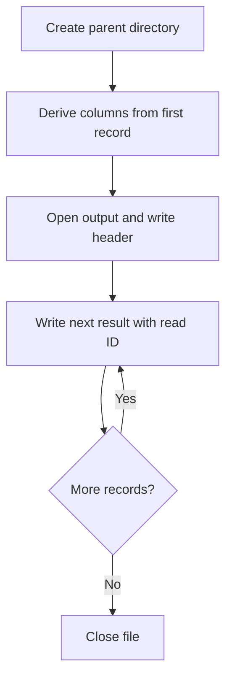

## Construct a deterministic step waveform

**Subroutine** `make_squiggle`

**Interface.** levels: float64[S], dwells: int[S] → float64[L], where L is the sum of the dwell counts.

**Memory.** O(S+L) values. Repetition and casting can briefly hold two length-L buffers.

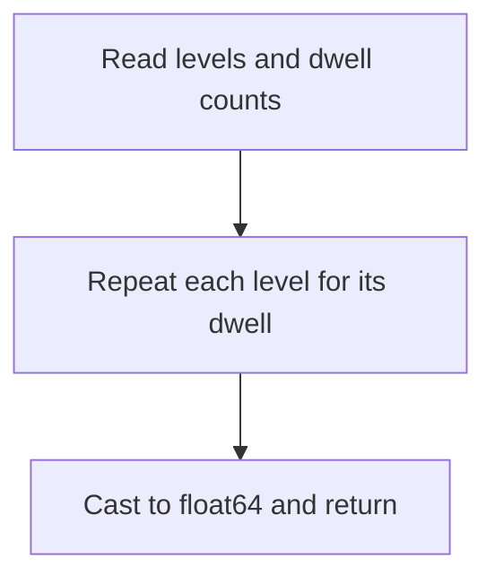

## Perturb a fixture

**Subroutine** `add_noise_and_spikes`

**Interface.** signal: float64[L], rng: Generator, noise_std: float, num_spikes: int → noisy: float64[L].

**Memory.** O(L) Gaussian draws and noisy output, plus O(num_spikes) index and sign values; sampling may allocate additional workspace.

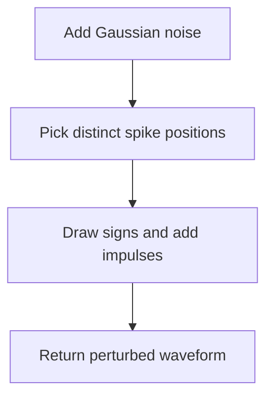

## Build the model inputs

**Subroutine** `generate_controlled_tests`

**Interface.** No arguments → reference: float64[100] and list of three dictionaries containing ID, title, expected label and signal array.

**Memory.** Outputs retain 1,122 float64 samples (8,976 bytes total) plus Python records, random-generation temporaries and CSV storage.

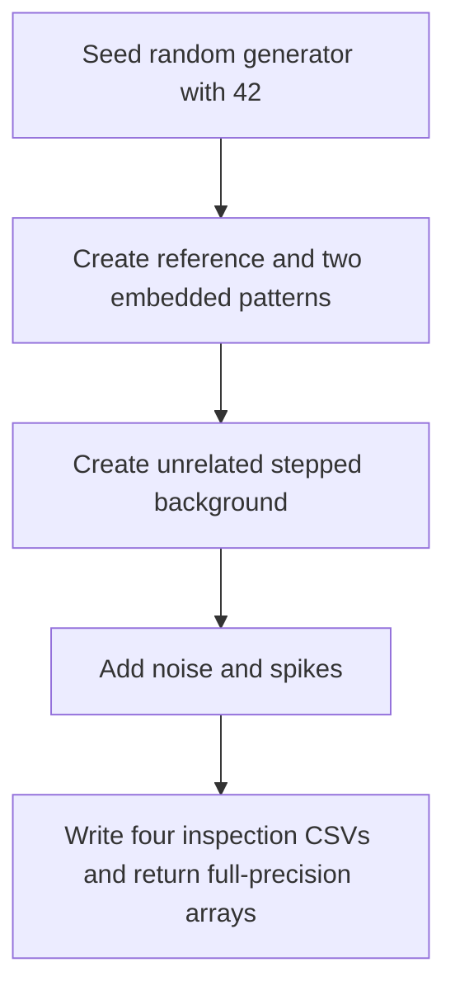

## Make the model printout

**Subroutine** `save_summary_plot`

**Interface.** target_ref: array, tests: list, results: list[MatchResult], plot_path: Path → PNG file.

**Memory.** O(total fixture samples) plotted vertices plus a figure raster proportional to pixel width × height.

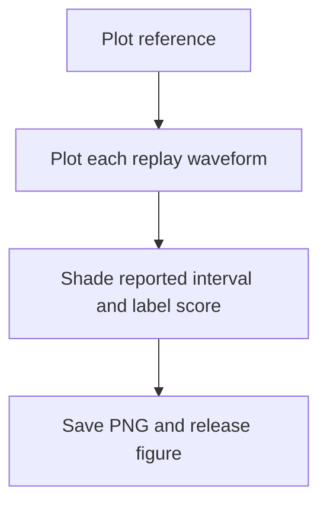

## Execute the simulation

**Subroutine** `main (reference model)`

**Interface.** No arguments → fixture CSVs, decision CSV, PNG and console output.

**Memory.** Retains the four input arrays and three result records; sequential matcher work dominates the numerical workspace.

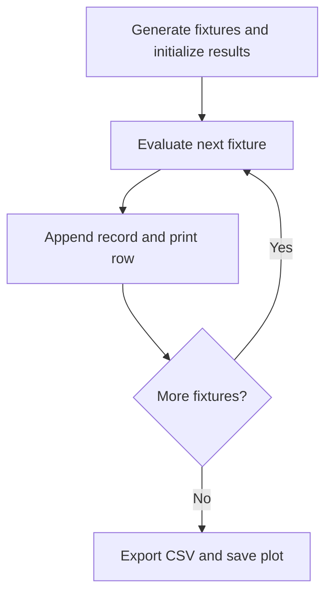

## Select executable source

**Subroutine** `stage_model`

**Interface.** checkout: Path, work: Path → five Python files in an isolated directory.

**Memory.** One Git blob in memory at a time; disk space equals the combined source size.

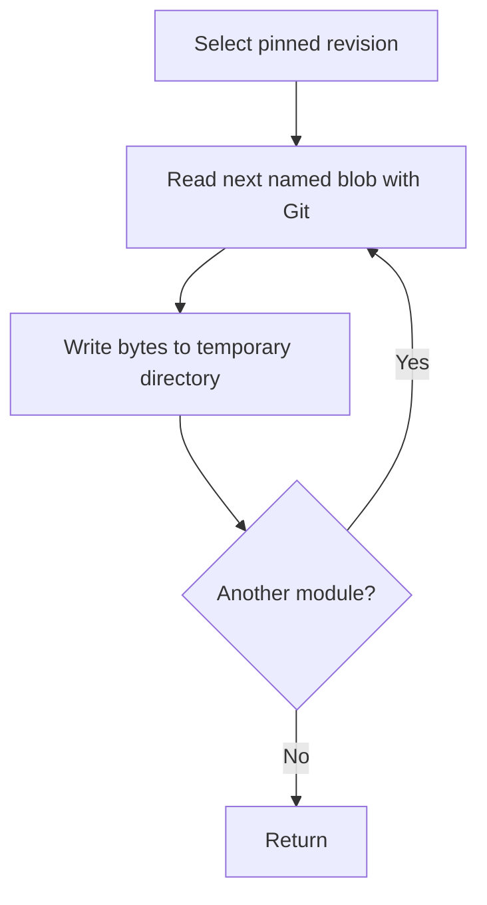

## Validate the result table

**Subroutine** `check_decisions`

**Interface.** csv_path: Path → None on success; ValueError on mismatch.

**Memory.** O(R) rows. The baseline checks three IDs, scores at exported precision, labels, spans, band width and threshold.

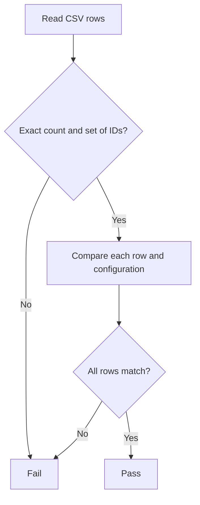

## Exercise four numerical edge cases

**Subroutine** `check_vectors`

**Interface.** model_dir: Path → None on success; raises on unexpected values.

**Memory.** Fixed-size float64 vectors of one to five elements and the model's temporary arrays.

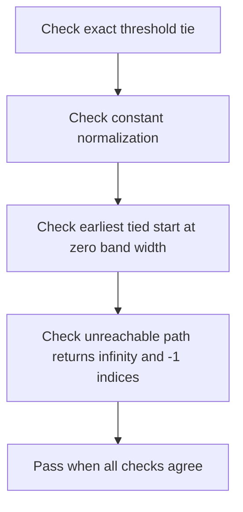

## Produce independently checked artifacts

**Subroutine** `run_suite`

**Interface.** checkout: Path, output: Path → CSV and PNG in output directory.

**Memory.** Temporary disk holds five source files and the generated fixtures, CSV and plot. Runs the model and checks sequentially.

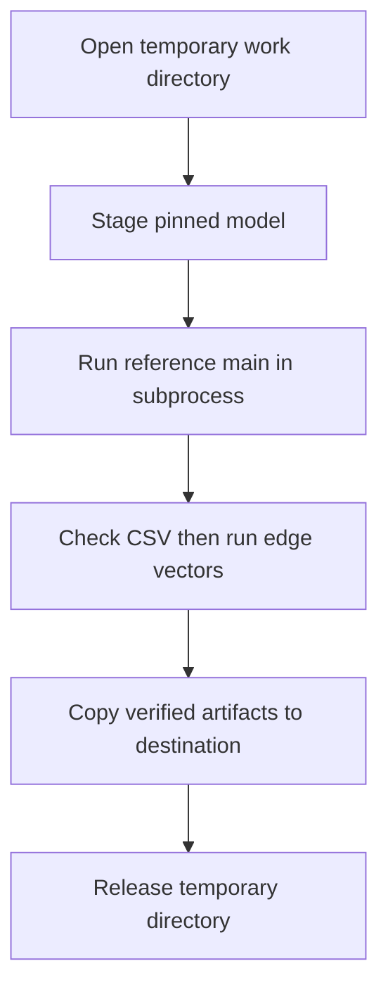

## Expose the team CLI

**Subroutine** `main (team verifier)`

**Interface.** Two path arguments from the shell → success exit or a nonzero error.

**Memory.** Two paths and argparse state, plus the workspace used by run_suite.

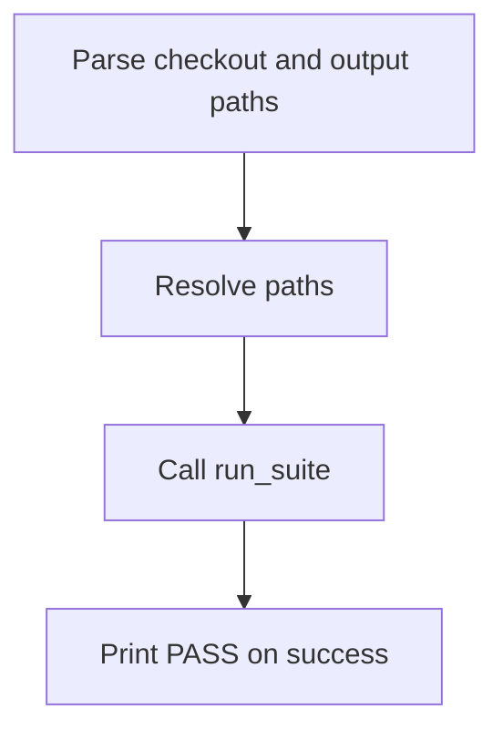
