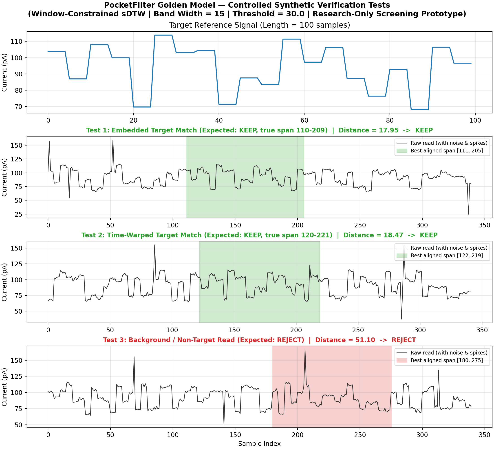

# Synthetic replay · sprint 01

On 25 November 2026 the workstation reproduced Hamza Kittaneh’s three-case replay from commit `63b6728ac48b8ef733e98085a1fd69e4e4b4bf26`. The team verifier reran the model in a temporary directory and checked the exported scores, decisions and inclusive spans against that revision. The record below is from the verifier run on Windows x64, CPython 3.11.7, NumPy 1.26.4 and Matplotlib 3.8.0.

| Synthetic fixture | Samples | Expected | Observed | Distance | Best span | Host time (ms) |
| --- | ---: | --- | --- | ---: | --- | ---: |
| Embedded pattern | 340 | KEEP | KEEP | 17.9474 | 111–205 | 163.50 |
| Variable dwell | 342 | KEEP | KEEP | 18.4654 | 122–219 | 156.41 |
| Unrelated pattern | 340 | REJECT | REJECT | 51.0970 | 180–275 | 165.43 |

The reference has 100 samples. The generator uses seed 42. Each replay uses median width 3, band half-width 15 and threshold 30. The first planted interval is 110–209 and the second is 120–221. In both cases the minimum-cost fit lies inside the planted interval. The third trace still has a least-cost interval, but its distance exceeds the threshold, so the model rejects it. The three fixtures establish deterministic regression cases. Estimating sensitivity or false-positive rate requires independently labeled recordings.

The timer encloses read and reference preprocessing, matching, and classification on a single host call. It excludes fixture generation, disk export, plotting and board transfers. The 2,000,000 accepted samples/s for 60 seconds in the design report remains a board-level target.

[Observed CSV](sprint-01/results.csv) · [Reproduction instructions](../../software/README.md)

## First integration vector

For a host-to-HLS comparison, begin with read and reference both equal to [0, 1, 0], median width 1, band half-width 0 and threshold 0. The host returns distance 0, inclusive indices [0, 2] and KEEP. Propose exact agreement on indices and decision, and exact zero distance for this identical-vector case. The general fixed-point tolerance remains a team decision.

| Additional check executed | Expected and observed |
| --- | --- |
| Score exactly equals threshold | KEEP with distance 0 and span [0, 2] |
| Constant four-sample input | Z-score output is four zeros |
| Two identical, equal-cost subsequences | Width-zero matcher returns the earlier span [1, 2] |
| Reference cannot fit at width zero | Infinite distance and indices [−1, −1] |

## Recorded-data evaluation

The recorded validation now includes lambda FAST5 port-equivalence checks and a labeled ECG200 surrogate with a frozen threshold. Sponsor-labeled nanopore data and instrumented board results remain open. [Dataset provenance, evaluation and intake](recorded.md) · [Accelerator evidence](accelerator.md)
